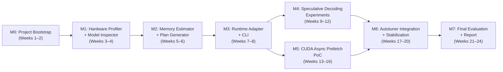
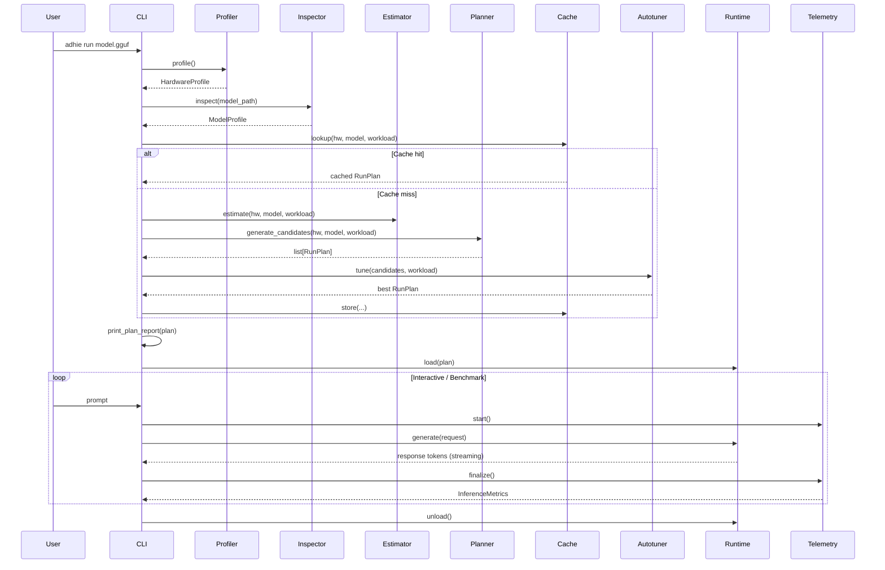

# ADHIE — Concrete Implementation Plan

**Incremental, module-by-module execution plan derived from the [Project Specification](file:///Users/apple/Downloads/ADHIE_Project_Specification.md)**

> [!IMPORTANT]
> This plan is organized into **7 Execution Modules**, each independently testable before moving on. Every module lists exact files to create, interfaces to implement, tests to write, and a clear **"done" gate**. The team should integrate after every module — never let parallel work diverge for more than 2 weeks.

---

## 📊 Module Status Tracker

| Module | Status | Tests | Key Notes |
|--------|--------|-------|-----------|
| **M0: Project Bootstrap** | ✅ Complete | 17 passing | All shared types, CLI scaffold, project config |
| **M1: Hardware Profiler + Model Inspector** | ✅ Complete | 51 passing | GPU/CPU/RAM detection, GGUF metadata reader, HF resolver |
| **M1-fix: GGUF Metadata Bug** | ✅ Complete | 8 new tests | Fixed field.data index dereference, removed deprecated `local_dir_use_symlinks` |
| **M2: Memory Estimator + Plan Generator** | ✅ Complete | 37 passing | Weight/KV estimation, binary search for max GPU layers, candidate generation |
| **M3: Runtime Adapter + Telemetry + Benchmark** | ✅ Complete | 38 passing | llama-server subprocess adapter, timing metrics, benchmark runner |
| **M3-fix: Split GGUF Support** | ✅ Complete | 22 new tests | Resolver groups/downloads all shards, inspector aggregates across shards |
| **M4: Speculative Decoding** | ✅ Complete | 46 passing | Controller, draft sweep, adaptive k, `adhie experiment` CLI |
| **M5: CUDA Async Prefetch** | ⬜ Skipped | — | Stretch goal, needs CUDA hardware |
| **M6: Autotuner Integration** | ✅ Complete | 49 passing | Autotuner, profile cache, runtime adaptation manager |
| **M7: Final Evaluation** | ✅ Complete | 21 passing | Benchmark matrix, ablation, report, comparison, demo scripts, plot generation |

**Total tests: 289 passing ✅** (as of Module 7 completion)

---

## High-Level Module Dependency Graph



---

## Module 0 — Project Bootstrap & Environment Setup
**Weeks 1–2 · All 3 Members**

### 0.1 Objectives
- Inventory all team hardware
- Select target & draft models
- Build & pin the llama.cpp backend
- Establish repository structure, CI, and shared tooling
- Achieve a single successful manual inference run

### 0.2 Tasks (Checklist)

| # | Task | Owner | Output |
|---|------|-------|--------|
| 0.1 | Create Git repo with the directory layout from §16.2 of the spec | M3 | Repo with skeleton dirs |
| 0.2 | Document each team member's machine: GPU name, VRAM, CPU model, cores, total RAM, OS, CUDA version, storage type | All | `configs/hardware_profiles/machine_*.yaml` |
| 0.3 | Select primary machine (lowest VRAM) and fallback machine | All | Decision doc in `docs/decisions/001-machines.md` |
| 0.4 | Select primary target model: **Qwen2.5-14B-Instruct** Q4_K_M GGUF (or similar 10–14B) | All | `docs/decisions/002-models.md` |
| 0.5 | Select compatible draft model: **Qwen2.5-0.5B-Instruct** Q4_K_M GGUF (same tokenizer family) | All | Same decision doc |
| 0.6 | Verify tokenizer compatibility: compare vocab, special tokens, chat template between target & draft | M2 | Validation script in `scripts/verify_tokenizer.py` |
| 0.7 | Clone, build, and pin llama.cpp at a specific commit with CUDA support | M1 | `scripts/setup_backend.sh` with pinned commit hash |
| 0.8 | Run a baseline manual inference: `llama-server --model target.gguf --gpu-layers 0 --ctx-size 4096` | M1 | Screenshot / log proving tokens generated |
| 0.9 | Define 3 benchmark prompts (short 2K, medium 8K, long 16K) and 2 output lengths (128, 256 tokens) | M3 | `configs/benchmark_workloads/default.yaml` |
| 0.10 | Set up Python project: `pyproject.toml`, virtual env, linting (ruff), formatting (black), type checking (mypy) | M3 | Runnable `pip install -e .` |
| 0.11 | Set up basic CI (GitHub Actions or local Makefile): lint + unit tests | M3 | `.github/workflows/ci.yaml` or `Makefile` |

### 0.3 Files Created

```
adhie/
├── pyproject.toml
├── Makefile
├── README.md
├── docs/
│   ├── project_specification.md          # Copy of the spec
│   ├── architecture.md                   # Stub
│   └── decisions/
│       ├── 001-machines.md
│       └── 002-models.md
├── configs/
│   ├── hardware_profiles/
│   │   ├── machine_low_vram.yaml
│   │   └── machine_fallback.yaml
│   ├── model_profiles/
│   │   ├── target_model.yaml             # Stub, filled in M1
│   │   └── draft_model.yaml              # Stub, filled in M1
│   └── benchmark_workloads/
│       └── default.yaml
├── src/
│   └── adhie/
│       ├── __init__.py
│       └── types.py                      # Shared dataclasses (empty stubs)
├── scripts/
│   ├── setup_backend.sh
│   └── verify_tokenizer.py
└── tests/
    └── __init__.py
```

### 0.4 Gate Criteria
- [ ] All team machines documented with YAML profiles
- [ ] Target model downloads and loads without OOM
- [ ] `llama-server` serves tokens from target model on primary machine
- [ ] Draft model tokenizer confirmed compatible
- [ ] Repo builds, lints, and has a passing trivial test

---

## Module 1 — Hardware Profiler + Model Inspector
**Weeks 3–4 · Primary: M3 (Profiler) + M1 (Inspector)**

### 1.1 Objectives
- Automated hardware detection and benchmarking
- Model metadata extraction from GGUF files
- Structured output for downstream estimator/planner

### 1.2 Component: Hardware Profiler

**File:** `src/adhie/profiler/hardware_profiler.py`

```python
# Core interface
@dataclass
class HardwareProfile:
    # Static GPU info
    gpu_name: str | None
    gpu_compute_capability: tuple[int, int] | None
    vram_total_bytes: int
    vram_free_bytes: int
    gpu_count: int

    # Static CPU info
    cpu_model: str
    cpu_physical_cores: int
    cpu_logical_cores: int
    cpu_freq_mhz: float | None
    simd_flags: list[str]          # e.g., ["avx2", "avx512f"]

    # Memory
    ram_total_bytes: int
    ram_available_bytes: int

    # Measured bandwidths (from microbenchmarks)
    h2d_bandwidth_bytes_s: float | None       # Host→Device
    d2h_bandwidth_bytes_s: float | None       # Device→Host
    ram_bandwidth_bytes_s: float | None       # CPU memory bandwidth
    gpu_mem_bandwidth_bytes_s: float | None   # GPU HBM/GDDR bandwidth

    # PCIe
    pcie_gen: int | None
    pcie_width: int | None

    # Storage
    storage_type: str              # "ssd" | "hdd" | "unknown"
    storage_read_mbps: float | None

    # Runtime
    cuda_version: str | None
    driver_version: str | None
    vram_safety_margin_bytes: int  # Configurable, default 512MB

class HardwareProfiler:
    def profile(self) -> HardwareProfile: ...
```

**Implementation approach:**
1. **GPU static info:** Use `pynvml` (NVIDIA Management Library bindings) for GPU name, VRAM total/free, compute capability, driver version.
2. **CPU info:** Use `psutil` + `/proc/cpuinfo` (Linux) or `sysctl` (macOS) for cores, model, frequency. Parse CPU flags for SIMD.
3. **RAM:** Use `psutil.virtual_memory()`.
4. **Bandwidth microbenchmarks:**
   - H2D/D2H: Small PyCUDA or CuPy script that times `cudaMemcpy` of 64MB–256MB with pinned buffers, 5 iterations, take median.
   - RAM bandwidth: Use a simple NumPy large-array copy benchmark or `mbw` tool.
   - GPU memory bandwidth: Small kernel reading a large buffer, or use bandwidthTest from CUDA samples.
5. **PCIe:** Parse `nvidia-smi --query-gpu=pcie.link.gen.current,pcie.link.width.current --format=csv`.
6. **Storage:** Check mount type; optionally run `fio` sequential read test on model directory.
7. **Output:** Save to `configs/hardware_profiles/<hostname>_<timestamp>.yaml` using pydantic/dataclasses + YAML serialization.

**Tests:** `tests/unit/test_profiler.py`
- Test profile dataclass serialization/deserialization round-trip
- Test with mocked `pynvml` / `psutil` values
- Test graceful degradation when no GPU present (CPU-only fallback)

### 1.3 Component: Model Inspector

**File:** `src/adhie/inspector/model_inspector.py`

```python
@dataclass
class ModelProfile:
    model_id: str                  # Human-readable identifier
    model_path: str
    file_size_bytes: int

    # Architecture
    architecture: str              # "llama", "qwen2", "mistral", etc.
    model_family: str
    parameter_count: int
    layer_count: int
    hidden_size: int
    intermediate_size: int
    vocab_size: int

    # Attention
    num_attention_heads: int
    num_kv_heads: int              # Distinguishes GQA/MQA
    head_dim: int
    max_context: int
    attention_type: str            # "full", "sliding_window", "hybrid"
    sliding_window_size: int | None

    # Quantization
    weight_dtype: str              # "q4_k_m", "q8_0", "f16", etc.
    bits_per_weight: float         # Effective average

    # Tokenizer
    tokenizer_id: str
    chat_template: str | None

    # MoE (optional)
    is_moe: bool
    num_experts: int | None
    num_active_experts: int | None

    # Draft compatibility
    draft_model_path: str | None
    draft_compatible: bool | None  # Set after validation

class ModelInspector:
    def inspect(self, model_path: str) -> ModelProfile: ...
    def check_draft_compatibility(self, target: ModelProfile, draft: ModelProfile) -> bool: ...
```

**Implementation approach:**
1. **GGUF metadata:** Use the `gguf` Python package (from llama.cpp's repo) to read GGUF file headers. Key fields:
   - `general.architecture`, `general.name`
   - `*.block_count` (layers), `*.embedding_length` (hidden_size)
   - `*.attention.head_count`, `*.attention.head_count_kv`, `*.attention.key_length`
   - `*.context_length`, `*.feed_forward_length`
   - `tokenizer.ggml.model`, `tokenizer.ggml.tokens`
   - File-level quantization type from tensor metadata
2. **Parameter count:** Sum tensor sizes from GGUF tensor info, or use metadata field if present.
3. **Draft compatibility check:** Compare vocab size, tokenizer model, special token IDs.
4. **Output:** Save to `configs/model_profiles/<model_name>.yaml`.

**Tests:** `tests/unit/test_inspector.py`
- Test parsing a known GGUF file (use a tiny test model or mock the gguf reader)
- Test draft compatibility logic with matching/mismatching vocabs
- Test handling of MoE vs dense model metadata

### 1.4 Component: Baseline Benchmark Runner (v1)

**File:** `benchmarks/run_benchmark.py`

A simple script that:
1. Launches `llama-server` with specified args
2. Sends prompts via HTTP to the `/completion` or `/v1/chat/completions` endpoint
3. Measures and records: TTFT, TPOT, ITL, tokens/s, total time
4. Captures `nvidia-smi` for peak VRAM
5. Captures `psutil` for peak RAM
6. Writes results to `benchmarks/results/<run_id>.json`

**Test a few GPU-layer splits:** 0, 25%, 50%, 75%, 100% of layers on GPU.

### 1.5 Deliverables
- `HardwareProfile` and `ModelProfile` dataclasses with YAML persistence
- Profiler CLI: `python -m adhie.profiler` → prints + saves hardware profile
- Inspector CLI: `python -m adhie.inspector --model /path/to/model.gguf`
- Baseline benchmark data for 3–5 GPU layer splits
- Short bottleneck analysis doc: `docs/decisions/003-bottleneck-analysis.md`

### 1.6 Gate Criteria
- [ ] `HardwareProfile` correctly reports GPU, CPU, RAM, and measured bandwidths
- [ ] `ModelProfile` correctly extracts all fields from a real GGUF file
- [ ] Baseline benchmarks are repeatable (< 10% variance across 3 runs)
- [ ] Team has identified the dominant bottleneck (VRAM capacity / GPU bandwidth / PCIe / CPU compute / KV size)

---

## Module 2 — Memory Estimator + Plan Generator
**Weeks 5–6 · Primary: M3**

### 2.1 Objectives
- Estimate memory requirements for any model + hardware + context combination
- Generate feasible candidate run plans
- Reject infeasible configurations with clear explanations

### 2.2 Component: Memory Estimator

**File:** `src/adhie/estimator/memory_estimator.py`

```python
@dataclass
class MemoryEstimate:
    # Weight memory
    weight_total_bytes: int
    weight_gpu_bytes: int          # Based on gpu_layers
    weight_cpu_bytes: int

    # KV cache memory
    kv_per_token_bytes: float      # Per-token, per-sequence
    kv_total_bytes: int            # For requested context length
    kv_gpu_bytes: int
    kv_cpu_bytes: int

    # Runtime overhead
    cuda_context_bytes: int        # ~200-800MB typically
    execution_workspace_bytes: int # Activation buffers, scratch
    safety_margin_bytes: int

    # Budgets
    vram_budget_bytes: int         # total - display - safety
    vram_required_bytes: int       # weights_gpu + kv_gpu + runtime
    ram_budget_bytes: int
    ram_required_bytes: int

    # Feasibility
    is_feasible: bool
    bottleneck: str                # "vram" | "ram" | "both" | "none"
    warnings: list[str]

class MemoryEstimator:
    def estimate(
        self,
        hardware: HardwareProfile,
        model: ModelProfile,
        context_length: int,
        gpu_layers: int,
        kv_dtype: str = "f16",
        kv_offload: bool = False,
    ) -> MemoryEstimate: ...
```

**Key formulas to implement:**

```python
# Weight memory per layer (approximate)
weight_per_layer = model.file_size_bytes / model.layer_count  # rough

# KV cache per token (from spec §3.2)
kv_per_token = (2 * model.layer_count * model.num_kv_heads
                * model.head_dim * bytes_per_element(kv_dtype))

# Total KV for context
kv_total = kv_per_token * context_length

# VRAM budget
vram_budget = (hardware.vram_free_bytes
               - cuda_context_overhead      # ~300MB default
               - execution_workspace         # ~200MB default
               - hardware.vram_safety_margin_bytes)

# GPU weight capacity
gpu_weight_bytes = gpu_layers * weight_per_layer

# Feasibility check
vram_needed = gpu_weight_bytes + (kv_total if not kv_offload else 0)
is_feasible = vram_needed <= vram_budget
```

> [!NOTE]
> These are estimates, not exact values. The estimator should produce ranges (optimistic/pessimistic) and validate against actual peak memory during warm-up (Module 3).

**Tests:** `tests/unit/test_estimator.py`
- Test known model (14B Q4_K_M, 40 layers, GQA 8 KV heads) against hand-calculated values
- Test feasibility boundary: find the exact gpu_layers threshold for a 4GB GPU
- Test KV scaling: verify linear growth with context length
- Test infeasible detection with appropriate warnings

### 2.3 Component: Plan Generator

**File:** `src/adhie/planner/plan_generator.py`

```python
@dataclass
class RunPlan:
    # Identification
    plan_id: str
    rationale: str                 # Human-readable explanation

    # Backend
    backend: str                   # "llamacpp"
    model_path: str
    model_format: str

    # GPU/CPU placement
    gpu_layers: int
    cpu_threads: int
    cpu_threads_draft: int | None

    # Context
    context_length: int
    batch_size: int                # llama.cpp -b
    ubatch_size: int               # llama.cpp -ub

    # KV cache
    kv_type_k: str                 # "f16", "q8_0", "q4_0"
    kv_type_v: str
    kv_offload: bool

    # Speculative decoding
    draft_model_path: str | None
    draft_device: str              # "cpu", "gpu", "none"
    draft_length: int
    draft_threads: int | None

    # Memory estimates
    estimated_vram_bytes: int
    estimated_ram_bytes: int
    memory_headroom_pct: float

    # Predicted execution mode (from spec §7)
    execution_mode: str            # "gpu_resident", "hybrid", "cpu_first", "streaming"

class PlanGenerator:
    def generate_candidates(
        self,
        hardware: HardwareProfile,
        model: ModelProfile,
        workload: WorkloadConfig,
    ) -> list[RunPlan]: ...

    def _enumerate_gpu_splits(self, model, vram_budget) -> list[int]: ...
    def _enumerate_kv_options(self, model, context, vram_remaining) -> list[dict]: ...
    def _enumerate_draft_options(self, model, hardware) -> list[dict]: ...
    def _reject_infeasible(self, candidates) -> list[RunPlan]: ...
```

**Candidate generation strategy (deliberately small set):**

```
GPU layer splits:   [0, 25%, 50%, 75%, 100%] of layers   → 5 values
KV type:            [f16, q8_0]                           → 2 values
KV offload:         [False, True]                         → 2 values
Draft mode:         [none, cpu_draft]                     → 2 values (Phase 3)
```

Total raw: 5 × 2 × 2 × 2 = 40 combinations → after feasibility rejection, typically 5–15 viable candidates.

**Rejection rules:**
1. `estimated_vram > vram_budget` → REJECT
2. `estimated_ram > ram_budget` → REJECT
3. `gpu_layers == 0 and kv_offload == False` → REJECT (no GPU but KV on GPU)
4. `draft_device == "gpu" and draft + target > vram_budget` → REJECT
5. Context length > model's max_context → REJECT

### 2.4 Deliverables
- Memory estimator with unit tests against known model dimensions
- Plan generator producing ranked candidate lists
- CLI: `python -m adhie.planner --model /path/to/model.gguf` → prints candidates with rationale
- Candidates saved to `configs/run_plans/`

### 2.5 Gate Criteria
- [ ] Estimator produces values within 20% of actual measured VRAM/RAM (validated in Module 3)
- [ ] Generator rejects all infeasible plans for the 4GB GPU test case
- [ ] Generator produces at least 3 viable plans for the primary machine
- [ ] Each plan includes a human-readable rationale

---

## Module 3 — Runtime Adapter + CLI (`adhie run`)
**Weeks 7–8 · Primary: M1**

### 3.1 Objectives
- Wrap llama.cpp in a clean adapter with load/generate/metrics/unload
- Build the `adhie run <model>` CLI end-to-end
- Validate memory estimates against actual runtime usage
- Produce the first ADHIE-selected vs baseline comparison

### 3.2 Component: Runtime Adapter

**File:** `src/adhie/runtime/base.py`

```python
class RuntimeAdapter(ABC):
    @abstractmethod
    def load(self, plan: RunPlan) -> None: ...

    @abstractmethod
    def generate(self, request: GenerateRequest) -> GenerateResponse: ...

    @abstractmethod
    def metrics(self) -> RuntimeMetrics: ...

    @abstractmethod
    def unload(self) -> None: ...

    @abstractmethod
    def health_check(self) -> bool: ...
```

**File:** `src/adhie/runtime/llamacpp_adapter.py`

```python
class LlamaCppAdapter(RuntimeAdapter):
    """
    Manages a llama-server subprocess.
    Translates RunPlan → llama-server CLI args.
    Communicates via HTTP API.
    """

    def __init__(self, llama_server_path: str):
        self.server_path = llama_server_path
        self.process: subprocess.Popen | None = None
        self.base_url: str = "http://127.0.0.1:8080"

    def load(self, plan: RunPlan) -> None:
        """Build CLI args from RunPlan, start llama-server subprocess."""
        args = self._build_args(plan)
        self.process = subprocess.Popen(args, ...)
        self._wait_for_ready()  # Poll /health endpoint

    def _build_args(self, plan: RunPlan) -> list[str]:
        """
        Translate RunPlan fields to llama-server flags:
          --model, --gpu-layers, --ctx-size, --threads,
          --cache-type-k, --cache-type-v,
          --model-draft, --device-draft, --threads-draft,
          --spec-type, --spec-draft-n-max, etc.
        """
        ...

    def generate(self, request: GenerateRequest) -> GenerateResponse:
        """POST to /v1/chat/completions with streaming, measure timing."""
        ...

    def metrics(self) -> RuntimeMetrics:
        """Collect from server /metrics endpoint + nvidia-smi + psutil."""
        ...

    def unload(self) -> None:
        """Terminate the server subprocess cleanly."""
        ...
```

**Key implementation details:**
- Use `subprocess.Popen` with stdout/stderr capture for server logs
- Wait for `/health` to return 200 before sending requests
- Stream responses via SSE to compute TTFT (time to first token chunk) and ITL
- Capture `nvidia-smi --query-gpu=memory.used --format=csv,noheader` periodically for peak VRAM
- Use `psutil.Process(pid).memory_info().rss` for process RAM

### 3.3 Component: CLI

**File:** `src/adhie/cli/main.py`

```python
# Usage: adhie run <model_path> [--context N] [--draft <draft_path>] [--verbose]
#        adhie profile                    # Run hardware profiler
#        adhie inspect <model_path>       # Inspect model metadata
#        adhie plan <model_path>          # Show candidate plans
#        adhie benchmark <model_path>     # Run benchmark suite

@click.group()
def cli(): ...

@cli.command()
@click.argument("model_path")
@click.option("--context", default=8192)
@click.option("--draft", default=None)
@click.option("--verbose", is_flag=True)
def run(model_path, context, draft, verbose):
    """Main entry point: profile → inspect → plan → run."""
    hw = HardwareProfiler().profile()
    model = ModelInspector().inspect(model_path)
    candidates = PlanGenerator().generate_candidates(hw, model, workload)
    best_plan = candidates[0]  # Sorted by score (Module 6 adds autotuning)

    print_plan_report(best_plan)  # Show what was selected and why

    adapter = LlamaCppAdapter(LLAMA_SERVER_PATH)
    adapter.load(best_plan)
    # Enter interactive chat or run benchmark prompts
```

### 3.4 Component: Telemetry Collector

**File:** `src/adhie/telemetry/collector.py`

```python
@dataclass
class InferenceMetrics:
    ttft_ms: float
    tpot_ms: float
    itl_ms_list: list[float]       # Per-token inter-token latencies
    itl_p95_ms: float
    output_tokens_per_s: float
    prompt_tokens_per_s: float
    total_output_tokens: int
    total_time_s: float
    peak_vram_bytes: int
    peak_ram_bytes: int
    cpu_utilization_pct: float
    gpu_utilization_pct: float | None

class TelemetryCollector:
    """Collects metrics during a generation request."""
    def start(self): ...
    def record_first_token(self): ...
    def record_token(self): ...
    def finalize(self) -> InferenceMetrics: ...
```

### 3.5 Deliverables
- Working `adhie run <model>` that profiles, plans, and runs inference
- Plan report printed to terminal showing selected config + rationale
- Telemetry data captured per request
- Memory estimate validation: compare estimated vs actual VRAM/RAM
- First ADHIE-selected vs backend-default comparison

### 3.6 Gate Criteria
- [ ] `adhie run <model>` works end-to-end on primary machine
- [ ] Memory estimates within 20% of measured peaks
- [ ] TTFT, TPOT, tokens/s are captured and match manual measurements
- [ ] `adhie plan` shows candidates with feasibility and rationale
- [ ] Server starts and stops cleanly (no zombie processes)

---

## Module 4 — Speculative Decoding Experiments
**Weeks 9–12 · Primary: M2**

### 4.1 Objectives
- Implement CPU-draft / GPU-target speculative decoding via llama.cpp
- Benchmark all 5 placement variants from the spec (§9.5)
- Implement adaptive draft-length controller
- Identify regimes where speculation helps vs hurts

### 4.2 Component: Speculative Decoding Controller

**File:** `src/adhie/speculative/controller.py`

```python
@dataclass
class SpecConfig:
    enabled: bool
    draft_model_path: str | None
    draft_device: str              # "cpu" | "gpu" | "none"
    draft_length: int              # k value
    draft_threads: int
    spec_type: str                 # "draft-simple" | "none"

@dataclass
class SpecMetrics:
    draft_time_ms: float
    verify_time_ms: float
    proposed_tokens: int
    accepted_tokens: int
    acceptance_rate: float
    acceptance_by_position: list[float]  # Per-position acceptance rate
    effective_tokens_per_s: float
    speedup_vs_baseline: float | None

class SpeculativeController:
    def configure(self, target: ModelProfile, draft: ModelProfile,
                  hardware: HardwareProfile) -> SpecConfig: ...

    def build_experiment_matrix(self) -> list[SpecConfig]:
        """Generate the 5 variants from spec §9.5"""
        variants = []
        # A: No speculation (baseline)
        variants.append(SpecConfig(enabled=False, ...))
        # B: CPU draft + GPU target (ADHIE hypothesis)
        variants.append(SpecConfig(enabled=True, draft_device="cpu", ...))
        # C: GPU draft + GPU target (if VRAM permits)
        if self._draft_fits_on_gpu():
            variants.append(SpecConfig(enabled=True, draft_device="gpu", ...))
        # D: CPU draft + CPU target (low-VRAM comparison)
        variants.append(SpecConfig(enabled=True, draft_device="cpu",
                                   ...))  # With gpu_layers=0
        # E: N-gram draft (if llama.cpp supports)
        variants.append(...)
        return variants
```

### 4.3 Component: Draft Length Sweep

**File:** `src/adhie/speculative/draft_sweep.py`

```python
class DraftLengthSweep:
    """Sweep k ∈ {2, 4, 6, 8} for each spec variant."""

    def run(self, adapter: RuntimeAdapter, variant: SpecConfig,
            workload: WorkloadConfig) -> list[SpecMetrics]:
        results = []
        for k in [2, 4, 6, 8]:
            variant.draft_length = k
            plan = self._make_plan(variant)
            adapter.load(plan)
            metrics = self._benchmark(adapter, workload)
            results.append(metrics)
            adapter.unload()
        return results
```

### 4.4 Component: Adaptive Draft Controller

**File:** `src/adhie/speculative/adaptive.py`

```python
class AdaptiveDraftController:
    """
    Runtime adaptation of draft length based on recent acceptance.

    Simple rule-based policy:
    - Track rolling window of last N speculative cycles
    - If acceptance_rate > threshold_high → increase k (try longer drafts)
    - If acceptance_rate < threshold_low → decrease k (shorter drafts)
    - If speedup_vs_baseline < 1.0 → disable speculation entirely
    """

    def __init__(self, candidate_lengths: list[int] = [2, 4, 6, 8],
                 window_size: int = 20):
        self.candidates = candidate_lengths
        self.window: deque[SpecMetrics] = deque(maxlen=window_size)
        self.current_k_idx: int = 1  # Start at k=4

    def update(self, metrics: SpecMetrics) -> int:
        """Return the next draft length to use."""
        self.window.append(metrics)
        avg_acceptance = mean(m.acceptance_rate for m in self.window)

        if avg_acceptance > 0.7 and self.current_k_idx < len(self.candidates) - 1:
            self.current_k_idx += 1
        elif avg_acceptance < 0.3 and self.current_k_idx > 0:
            self.current_k_idx -= 1

        return self.candidates[self.current_k_idx]

    def should_disable(self) -> bool:
        """Disable speculation if it's consistently slower."""
        if len(self.window) < 10:
            return False
        avg_speedup = mean(m.speedup_vs_baseline for m in self.window
                          if m.speedup_vs_baseline is not None)
        return avg_speedup < 0.95  # 5% tolerance
```

### 4.5 Experiment Protocol

| Experiment | Fixed Variables | Swept Variables | Metrics |
|-----------|----------------|-----------------|---------|
| Baseline (A) | Model, context, prompt, sampling | None | TTFT, TPOT, ITL, tok/s |
| CPU draft sweep (B) | Target GPU layers, context | k ∈ {2,4,6,8}, draft threads | Same + acceptance rate |
| GPU draft (C) | Same | k ∈ {2,4,6,8} | Same + VRAM impact |
| CPU-only (D) | gpu_layers=0 | k ∈ {2,4,6,8} | Same |
| Adaptive (B+adaptive) | Same as B | Adaptive k | Same + k trajectory |

Each experiment: 3 prompts × 3 runs = 9 measurements minimum. Record all to JSON.

### 4.6 Deliverables
- Speculative decoding experiment report: `docs/experiments/speculative_decoding.md`
- Per-variant benchmark results in `benchmarks/results/spec_*.json`
- Adaptive draft controller with tests
- Clear identification of regimes: "CPU draft helps when...", "CPU draft hurts when..."
- Comparison plots (matplotlib): tok/s vs k, acceptance vs position

### 4.7 Gate Criteria
- [ ] All 5 variants benchmarked on at least 1 hardware profile
- [ ] End-to-end benefit demonstrated on at least 1 regime OR system correctly disables speculation
- [ ] Adaptive controller changes k based on acceptance rate (unit test + integration test)
- [ ] Greedy output equivalence verified: target-only == speculative for identical seeds

---

## Module 5 — CUDA Async Prefetch Proof-of-Concept
**Weeks 13–16 · Primary: M1**

> [!WARNING]
> This is a **stretch module**. Only proceed if Module 3 is stable and the team has CUDA development experience. The spec explicitly marks this as a go/no-go experiment.

### 5.1 Objectives
- Build isolated CUDA microbenchmark for H2D + compute overlap
- Verify overlap in Nsight Systems
- Compare against CPU execution of offloaded layers
- Make a go/no-go decision on integration

### 5.2 Component: Async Copy-Compute Microbenchmark

**File:** `cuda_experiments/async_copy_compute/benchmark.cu`

```cpp
// Simplified structure:
// 1. Allocate pinned host buffer (layer-sized, e.g., 200MB)
// 2. Allocate 2× device buffers (double buffering)
// 3. Create compute_stream and transfer_stream (non-blocking)
// 4. Pipeline: transfer layer N+1 while computing layer N
// 5. Use CUDA events for synchronization and timing
// 6. Compare: sequential time vs pipelined time

// Measure:
// - T_transfer_only (H2D isolated)
// - T_compute_only (kernel isolated)
// - T_sequential (H2D then compute, per layer)
// - T_pipelined (overlapped)
// - Overlap fraction = 1 - (T_pipelined / (T_transfer + T_compute))
```

**File:** `cuda_experiments/async_copy_compute/Makefile`

### 5.3 Experiment Protocol

| Test | What it measures | Go condition |
|------|-----------------|--------------|
| Isolated H2D bandwidth | Effective PCIe bandwidth for layer-sized transfers | Must match 70%+ of theoretical |
| Isolated compute | GPU kernel time for representative layer ops | Baseline |
| Sequential layers | Sum of transfer + compute per layer | Baseline total |
| Pipelined layers | Overlapped transfer + compute | Must be < 90% of sequential |
| Nsight verification | Visual confirmation of overlap | Streams must overlap in timeline |
| CPU execution comparison | Same offloaded layers run on CPU | Pipeline must beat CPU |

### 5.4 Go/No-Go Decision

```
IF pipelined_time < 0.85 * sequential_time
   AND pipelined_time < cpu_execution_time
   AND overlap confirmed in Nsight timeline
THEN → proceed with integration into one experimental layer path
ELSE → document the bottleneck, archive the benchmark, do NOT integrate
```

### 5.5 Deliverables
- CUDA microbenchmark code in `cuda_experiments/`
- Nsight Systems timeline screenshots
- Timing comparison table
- Go/no-go decision document: `docs/decisions/004-cuda-prefetch.md`
- If GO: minimal integration path for one layer type

### 5.6 Gate Criteria
- [ ] Microbenchmark runs and produces timing data
- [ ] Nsight Systems captures analyzed
- [ ] Clear written go/no-go decision with supporting data
- [ ] No integration happens without positive measurement

---

## Module 6 — Autotuner Integration & Stabilization
**Weeks 17–20 · All 3 Members**

### 6.1 Objectives
- Combine all components into the integrated ADHIE pipeline
- Implement startup autotuning (benchmark top candidates, select best)
- Add safe runtime adaptation
- Save/load machine profiles and selected configurations
- Polish CLI output and configuration reporting

### 6.2 Component: Candidate Evaluator (Autotuner)

**File:** `src/adhie/planner/autotuner.py`

```python
class Autotuner:
    """
    Phase A: Startup autotuning.
    1. PlanGenerator produces candidates
    2. MemoryEstimator rejects infeasible ones
    3. Autotuner benchmarks top-N candidates with short warm-up runs
    4. Scores each using objective function
    5. Selects and caches best plan
    """

    def __init__(self, adapter: RuntimeAdapter, max_candidates: int = 5,
                 warmup_tokens: int = 64, benchmark_tokens: int = 128):
        ...

    def tune(self, candidates: list[RunPlan],
             workload: WorkloadConfig) -> RunPlan:
        scored = []
        for plan in candidates[:self.max_candidates]:
            try:
                self.adapter.load(plan)
                metrics = self._short_benchmark(workload)
                score = self._score(plan, metrics)
                scored.append((plan, metrics, score))
            except OOMError:
                continue  # Skip, memory estimate was wrong
            finally:
                self.adapter.unload()

        scored.sort(key=lambda x: x[2])  # Lower is better
        best_plan, best_metrics, best_score = scored[0]

        self._cache_result(best_plan, best_metrics)
        return best_plan

    def _score(self, plan: RunPlan, metrics: InferenceMetrics) -> float:
        """
        J(c) = w1 * P95_TPOT + w2 * P95_TTFT + w3 * MemPenalty + w4 * QualPenalty
        (from spec §11.3)
        """
        w1, w2, w3, w4 = 0.5, 0.2, 0.2, 0.1
        mem_penalty = max(0, (metrics.peak_vram_bytes / plan.estimated_vram_bytes) - 0.9) * 1000
        return (w1 * metrics.tpot_ms +
                w2 * metrics.ttft_ms +
                w3 * mem_penalty +
                w4 * 0)  # Quality penalty deferred
```

### 6.3 Component: Profile Cache

**File:** `src/adhie/planner/profile_cache.py`

```python
class ProfileCache:
    """
    Caches (hardware_hash, model_hash, workload_hash) → RunPlan.
    On subsequent runs with the same setup, skip autotuning and reuse.
    """
    CACHE_DIR = Path("~/.adhie/profiles").expanduser()

    def lookup(self, hw: HardwareProfile, model: ModelProfile,
               workload: WorkloadConfig) -> RunPlan | None: ...

    def store(self, hw: HardwareProfile, model: ModelProfile,
              workload: WorkloadConfig, plan: RunPlan,
              metrics: InferenceMetrics) -> None: ...

    def _hash_key(self, hw, model, workload) -> str: ...
```

### 6.4 Component: Runtime Adaptation Manager

**File:** `src/adhie/runtime/adaptation.py`

```python
class RuntimeAdaptationManager:
    """
    Phase B: Safe runtime adaptation.
    Only adapts parameters that can change without model reload:
    - Draft length (via AdaptiveDraftController)
    - Speculation enable/disable
    - Future-request KV precision (between requests)
    - CPU thread budget (between requests)
    """

    def __init__(self, spec_controller: AdaptiveDraftController):
        self.spec_controller = spec_controller

    def on_request_complete(self, metrics: InferenceMetrics,
                           spec_metrics: SpecMetrics | None) -> dict:
        """Returns dict of parameter adjustments for next request."""
        adjustments = {}
        if spec_metrics:
            new_k = self.spec_controller.update(spec_metrics)
            adjustments["draft_length"] = new_k
            if self.spec_controller.should_disable():
                adjustments["speculation_enabled"] = False
        return adjustments
```

### 6.5 Integration: Full `adhie run` Pipeline



### 6.6 CLI Output Design

```
╔══════════════════════════════════════════════════════════╗
║                    ADHIE Run Report                      ║
╠══════════════════════════════════════════════════════════╣
║ Hardware:  NVIDIA RTX 3060 (6GB) · AMD Ryzen 7 (16T)   ║
║ Model:     Qwen2.5-14B-Instruct Q4_K_M (14.7B params)  ║
║ Context:   8192 tokens                                   ║
╠══════════════════════════════════════════════════════════╣
║ SELECTED PLAN:                                           ║
║   Execution Mode:  Hybrid (24/40 layers on GPU)          ║
║   KV Cache:        Q8_0 on GPU                           ║
║   Speculation:     CPU draft (k=4, Qwen2.5-0.5B)        ║
║   CPU Threads:     12 target + 4 draft                   ║
║   Est. VRAM:       5.2 GB / 5.6 GB budget                ║
║   Est. RAM:        8.1 GB / 28 GB available              ║
╠══════════════════════════════════════════════════════════╣
║ WHY THIS PLAN:                                           ║
║   • 14B Q4_K_M needs ~8.2GB for weights; 24 layers fit   ║
║     in 5.6GB VRAM budget after KV + runtime reserves     ║
║   • Q8 KV saves ~1.2GB vs F16 at 8K context             ║
║   • CPU draft frees GPU VRAM for target layers           ║
║   • Tested 5 candidates; this scored best on TPOT        ║
╠══════════════════════════════════════════════════════════╣
║ PERFORMANCE:                                             ║
║   TTFT:           1.2s (P95: 1.4s)                       ║
║   TPOT:           85ms (P95: 102ms)                      ║
║   Output tok/s:   11.8                                   ║
║   Peak VRAM:      5.1 GB                                 ║
║   Peak RAM:       7.8 GB                                 ║
║   Draft accept:   62% (avg 2.5 tokens/cycle)             ║
╚══════════════════════════════════════════════════════════╝
```

### 6.7 Deliverables
- Integrated ADHIE prototype with `adhie run`, `adhie profile`, `adhie inspect`, `adhie plan`, `adhie benchmark`
- Autotuner with candidate scoring
- Profile cache for repeat runs
- Runtime adaptation for draft length
- Polished CLI report
- End-to-end integration tests

### 6.8 Gate Criteria
- [ ] `adhie run <model>` works from cold start: profile → plan → run → report
- [ ] Autotuner selects a plan that matches or beats a reasonable manual config
- [ ] Profile cache works: second run skips autotuning
- [ ] Runtime adaptation adjusts draft length based on observed acceptance

---

## Module 7 — Final Evaluation, Ablation & Report
**Weeks 21–24 · All 3 Members**

### 7.1 Objectives
- Comprehensive benchmark suite across the workload matrix
- Ablation studies isolating each feature's contribution
- Quality/correctness evaluation
- Final paper/report and reproducible demo

### 7.2 Benchmark Matrix

| Dimension | Values |
|-----------|--------|
| Hardware | Primary (low VRAM), Fallback (if available) |
| Model | 14B Q4_K_M target + 0.5B draft |
| Context | 2K, 8K, 16K |
| Output | 128, 256 tokens |
| GPU layers | 0%, 50%, ADHIE-selected, 100% (if fits) |
| KV type | F16, Q8_0 |
| KV offload | On, Off |
| Speculation | None, CPU-draft k=4, CPU-draft adaptive, GPU-draft (if fits) |
| Runs per config | 3 minimum (report median + P95) |

### 7.3 Ablation Studies

| Ablation | What it isolates |
|----------|-----------------|
| ADHIE vs backend default | Value of automatic planning |
| ADHIE vs manual tuned | Value beyond manual effort |
| Speculation on vs off | Speculative decoding contribution |
| Adaptive k vs fixed k | Adaptive controller value |
| Q8 KV vs F16 KV | KV quantization impact on latency + memory |
| KV offload vs GPU KV | Offload overhead |
| CUDA prefetch vs CPU exec | (If Module 5 passed go/no-go) Prefetch value |

### 7.4 Quality Evaluation

```python
# tests/correctness/test_output_equivalence.py

def test_greedy_equivalence():
    """Target-only greedy == speculative greedy (same seed, same prompt)."""
    baseline_output = run_target_only(prompt, temperature=0)
    spec_output = run_speculative(prompt, temperature=0)
    assert baseline_output == spec_output

def test_kv_quantization_quality():
    """Compare perplexity on 100 samples: F16 KV vs Q8 KV."""
    ppl_f16 = measure_perplexity(kv_type="f16", samples=100)
    ppl_q8 = measure_perplexity(kv_type="q8_0", samples=100)
    assert ppl_q8 < ppl_f16 * 1.05  # Allow 5% degradation max
```

### 7.5 Final Report Structure

```
1. Abstract
2. Introduction & Motivation
3. Background & Related Work (llama.cpp, KTransformers, Dovetail, etc.)
4. System Design
   4.1 Hardware Profiler
   4.2 Model Inspector
   4.3 Memory Estimator
   4.4 Plan Generator & Autotuner
   4.5 Runtime Adapter
   4.6 Speculative Decoding Controller
   4.7 CUDA Prefetch Experiment
5. Experimental Setup
   5.1 Hardware configurations
   5.2 Models & quantization
   5.3 Workload matrix
   5.4 Reproducibility protocol
6. Results
   6.1 RQ1: Hardware-aware configuration vs defaults
   6.2 RQ2: CPU draft placement analysis
   6.3 RQ3: Adaptive draft length
   6.4 RQ4: KV cache placement/precision
   6.5 RQ5: Async layer prefetch (positive or negative result)
7. Ablation Studies
8. Discussion
   8.1 When ADHIE helps
   8.2 When ADHIE doesn't help
   8.3 Limitations
9. Conclusion & Future Work
10. References
```

### 7.6 Demo Script

**File:** `scripts/demo.sh`

```bash
#!/bin/bash
# ADHIE Final Demonstration Script

echo "=== Step 1: Hardware Profiling ==="
adhie profile --verbose

echo "=== Step 2: Model Inspection ==="
adhie inspect /models/qwen2.5-14b-instruct-q4_k_m.gguf

echo "=== Step 3: Automatic Planning ==="
adhie plan /models/qwen2.5-14b-instruct-q4_k_m.gguf \
    --draft /models/qwen2.5-0.5b-instruct-q4_k_m.gguf \
    --context 8192

echo "=== Step 4: Baseline Run (backend default) ==="
adhie benchmark /models/qwen2.5-14b-instruct-q4_k_m.gguf \
    --mode baseline --output results/baseline.json

echo "=== Step 5: ADHIE-Selected Run ==="
adhie benchmark /models/qwen2.5-14b-instruct-q4_k_m.gguf \
    --draft /models/qwen2.5-0.5b-instruct-q4_k_m.gguf \
    --mode auto --output results/adhie.json

echo "=== Step 6: Comparison Report ==="
adhie compare results/baseline.json results/adhie.json

echo "=== Step 7: Change Context & Replan ==="
adhie plan /models/qwen2.5-14b-instruct-q4_k_m.gguf --context 16384
```

### 7.7 Deliverables
- Complete benchmark results in `benchmarks/results/`
- Ablation tables and comparison plots
- Quality/correctness test results
- Final report (LaTeX or Markdown)
- Reproducible demo script
- Archived code release with pinned dependencies

### 7.8 Gate Criteria (Project Success)
- [ ] Same model + hardware tested under baseline AND ADHIE-selected config
- [ ] ADHIE explains why each plan was selected
- [ ] 10B+ model runs on memory-constrained machine
- [ ] At least 1 adaptive policy shows repeatable improvement on at least 1 regime
- [ ] System identifies regimes where an optimization is NOT useful and disables it
- [ ] All claims backed by repeatable measurements (≥3 runs)

---

## Team Ownership Summary

| Module | M1 (Runtime/CUDA) | M2 (Speculative) | M3 (Profiler/Planner) |
|--------|:-:|:-:|:-:|
| M0: Bootstrap | Build llama.cpp | Verify tokenizers | Repo setup, CI |
| M1: Profiler + Inspector | Model Inspector | — | Hardware Profiler, Benchmark Runner |
| M2: Estimator + Planner | Review | — | Memory Estimator, Plan Generator |
| M3: Runtime + CLI | **Runtime Adapter**, CLI | Telemetry helpers | CLI report formatting |
| M4: Spec Decoding | Support adapter changes | **All spec experiments** | Benchmark infrastructure |
| M5: CUDA Prefetch | **CUDA microbenchmark** | — | Measurement analysis |
| M6: Autotuner | Runtime adaptation hooks | Adaptive controller integration | **Autotuner**, Profile Cache |
| M7: Final Eval | Runtime stability | Spec decoding report section | **Benchmark suite**, plots, report |

> [!TIP]
> **Integration cadence:** Merge to `main` every 2 weeks. Each module ends with an integration test that exercises all components built so far. Never let experimental branches go stale.

---

## Dependencies & Python Packages

```toml
# pyproject.toml [project.dependencies]
dependencies = [
    "click>=8.0",          # CLI framework
    "pyyaml>=6.0",         # Config files
    "psutil>=5.9",         # System info
    "pynvml>=11.5",        # NVIDIA GPU info
    "requests>=2.28",      # HTTP to llama-server
    "sseclient-py>=1.8",   # SSE streaming for token events
    "matplotlib>=3.7",     # Plotting
    "numpy>=1.24",         # Numerical computation
    "rich>=13.0",          # Terminal formatting & tables
]

[project.optional-dependencies]
cuda = [
    "pycuda>=2022.1",      # CUDA microbenchmarks (Module 5)
    "cupy-cuda12x>=12.0",  # GPU bandwidth testing
]
dev = [
    "pytest>=7.0",
    "pytest-cov>=4.0",
    "ruff>=0.1",
    "black>=23.0",
    "mypy>=1.0",
]
```

---

## Quick-Start After This Plan Is Approved

```bash
# 1. Create the repo
mkdir adhie && cd adhie && git init

# 2. Copy specification
cp /path/to/ADHIE_Project_Specification.md docs/project_specification.md

# 3. Create project scaffold
# (Use Module 0 file list above)

# 4. Install
python -m venv .venv && source .venv/bin/activate
pip install -e ".[dev]"

# 5. First milestone: run llama-server manually
./scripts/setup_backend.sh
llama-server --model /models/target.gguf --gpu-layers 0 --ctx-size 4096
```

> [!IMPORTANT]
> **First Week Priority:** Get a single manual inference run working before writing any ADHIE code. If the backend doesn't work, nothing else matters.
